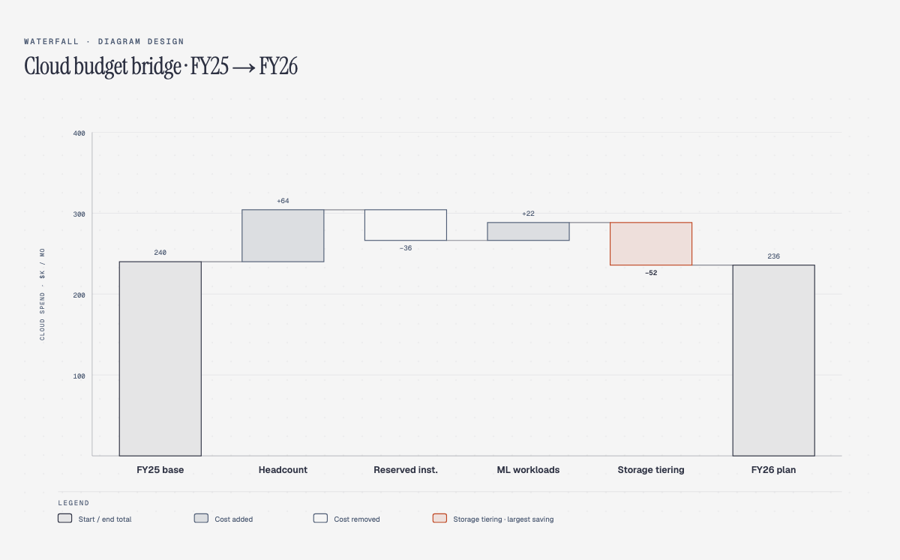

# A waterfall that looked right and failed verification

This is a constructed regression example, based on the shipped cloud-budget chart. Its reserved-instance savings label says **−36** and the end bar says **236**. The layout renders normally, but the declared walk is:

`240 + 64 − 36 + 22 − 52 = 238`

The end should therefore be **238**, not **236**.



Run the check from the repository root:

```sh
python3 scripts/verify-waterfall.py scripts/fixtures/waterfall-plausible-wrong.html
```

It exits 1 with this finding:

```text
'FY26 plan' (bar 6): declares 236 but the walk arrives at 238; the running total must conserve
```

The [HTML fixture](../../../scripts/fixtures/waterfall-plausible-wrong.html) and [regression test](../../../scripts/test-verify-waterfall.py) keep the example reproducible. This verifies consistency among the chart's declared numbers; confirming those numbers against a budget source still requires that source.
